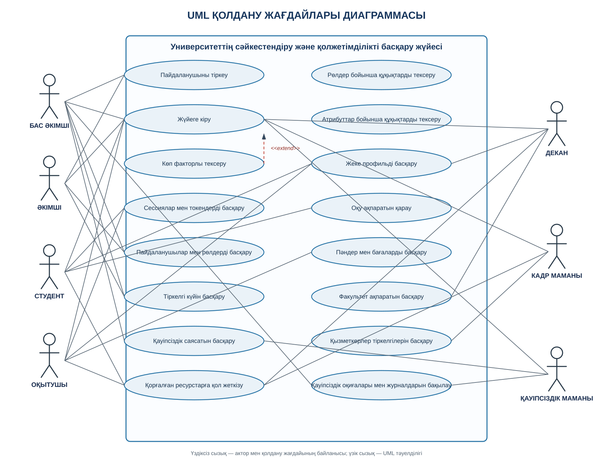

# Қолдану жағдайлары диаграммасы

Төменде University IAM Platform жүйесінің графикалық UML Use Case диаграммасы берілген.

[SVG диаграммасын бөлек ашу](use-case.svg) · [PlantUML бастапқы коды](use-case.puml)

## Рөлдер

- **Бас әкімші және әкімші:** пайдаланушыларды, рөлдерді, тіркелгі күйлерін басқару.
- **Студент:** оқу ақпаратын қарау, жеке профильді басқару және қорғалған ресурстарға қол жеткізу.
- **Оқытушы:** пәндер мен бағаларды басқару.
- **Декан:** факультет ақпаратын басқару.
- **Кадр маманы:** қызметкерлер тіркелгілерін басқару.
- **Қауіпсіздік маманы:** қауіпсіздік саясаты мен оқиғаларды бақылау.

## UML байланыстары

- **Ассоциация** — актор мен жүйедегі қолдану жағдайының байланысы.
- **`<<include>>`** — негізгі әрекеттің міндетті бөлігі.
- **`<<extend>>`** — шарт орындалғанда негізгі әрекетті кеңейтетін қосымша әрекет.
